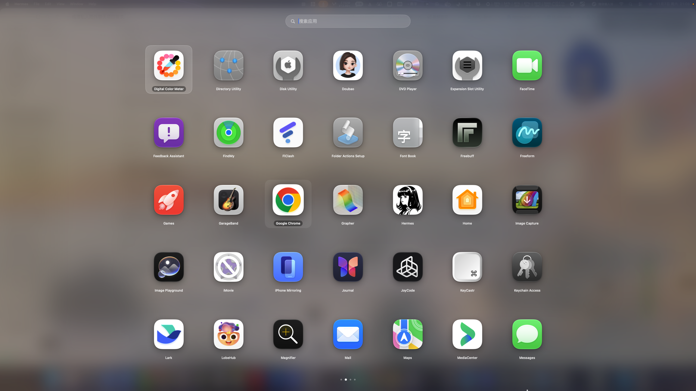
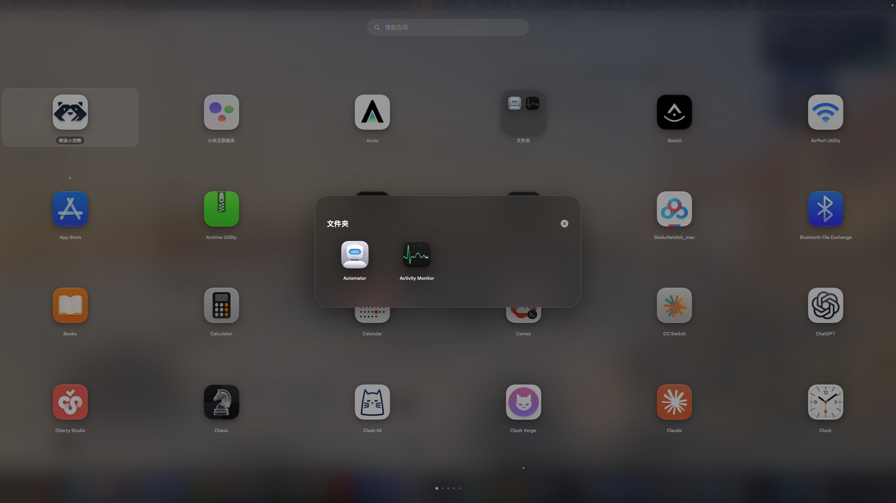
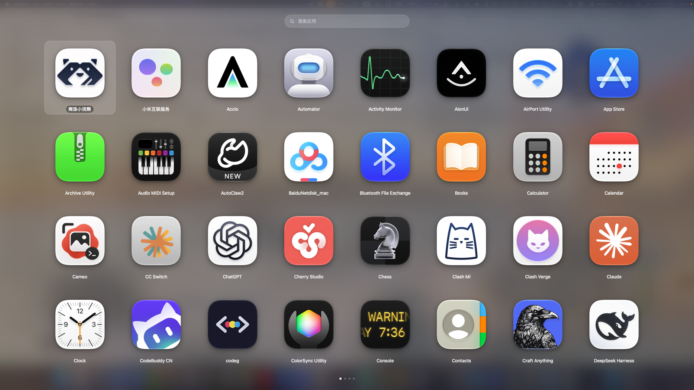

# LaunchDeck

一个自建的 macOS 启动器（Launchpad 风格），用 Craft Anything 的 **Deep 模式** 研究已发布的 LaunchOS 2.3.0 后独立实现，不含对方的代码、素材或字符串。

## 功能

- 全屏毛玻璃启动面板：模糊当前桌面壁纸 + 暗色遮罩，可关闭模糊或调暗度
- 自动扫描 `/Applications`、`/Applications/Utilities`、`/System/Applications`、`/System/Applications/Utilities`、`/System/Library/CoreServices/Applications`、`~/Applications`（含 `/Applications` 下一层子目录）
- **自适应网格**：只设置「横排几格 / 竖排几格 / 间距百分比 / 图标大小百分比」，图标先按行高推导再乘缩放系数，整块网格居中、四边留白一致；间距 10%–40%，图标 55%–100%
- **Dock 图标**：常驻 Dock，点一下（或 Cmd-Tab 切回）就会打开面板；切换到别的应用时面板自动收起
- **点击空白关闭**：左键点图标之外的任何背景区域（包括壁纸和网格空白处）立即退出面板
- **背景右键菜单**：在图标之外的背景上点右键 →「重新启动 LaunchDeck」「设置…」
- **动效**：面板打开时整体从 0.9 倍弹性放大、图标逐个错峰浮现；关闭时缩小淡出；点击应用时图标放大淡出再切到目标 App；文件夹展开为弹性缩放
- **翻页特效可切换**：滑动+淡入、丝滑平移（两页贴合无淡入）、淡入淡出、缩放、3D 翻转、无特效；所选特效优先，不会再叠加单元格入场动画
- **翻页交互**：触控板左右轻扫、鼠标滚轮上下滚动、在空白处按住拖动（>110 pt）都能翻页，底部圆点可点击跳页
- **文件夹**：把一个图标拖到另一个图标的中央即合并成文件夹；文件夹显示 2×2 预览，点击展开玻璃卡片，里面的应用可直接打开、右键卸载或「移出文件夹」；右键可重命名/解散
- **右键卸载**：应用图标右键 →「卸载…」，确认弹窗就在面板内部弹出（不会再被全屏面板挡住）；真正的移动在后台线程执行并显示「正在移到废纸篓…」，界面不会卡住；系统应用不显示该选项
- 顶部搜索：按名称或 bundle id 实时过滤，文件夹里的应用也会出现在结果中，结果同样分页
- 键盘：↑/↓ 移动选择、Return 打开（选中文件夹则展开）、Esc 逐层退出（文件夹 → 搜索词 → 面板）；搜索框自动获得焦点
- 鼠标：单击打开、悬停放大、右键菜单（打开 / Finder 显示 / 移出文件夹 / 隐藏 / 退出 / 从启动器隐藏 / 卸载）
- 拖拽：拖到图标中央建文件夹，拖到图标左/右边缘调整顺序（任何排序方式下都能拖，操作后会自动切回「自定义顺序」）；顺序、文件夹、隐藏列表持久化到 `~/Library/Application Support/LaunchDeck/layout.json`
- **热角呼出**：设置里可选用任一屏幕角落触发（关 / 左上 / 右上 / 左下 / 右下）
- **自定义快捷键**：设置里点「录制」，按下任意带修饰键的组合即可，立即生效并持久化
- **布局导入/导出**：把顺序、文件夹、隐藏列表、使用次数导出成 JSON，可在另一台机器导入
- **登录时启动**：通过 `SMAppService` 注册登录项，设置里开关
- **打开时隐藏 Dock 和菜单栏**：可选的全屏沉浸模式
- 排序模式：自定义 / 名称 / 使用频率 / 最近安装；启动次数会累计；运行中的应用图标下方有小白点
- 菜单栏常驻图标（左键开关面板，右键菜单：打开、设置、重新扫描、退出），同时在 Dock 保留一个可点击的图标



## 构建与安装

仓库里已经带了编译好的 `build/LaunchDeck.app`（v1.10，ad-hoc 签名），可以直接运行：

```bash
open build/LaunchDeck.app
```

从源码重新构建：

```bash
./build.sh                     # SwiftPM release 构建，产物在 build/LaunchDeck.app
open build/LaunchDeck.app      # 首次运行会自动弹出一次面板
```

安装到用户目录：

```bash
cp -R build/LaunchDeck.app ~/Applications/
open ~/Applications/LaunchDeck.app
```

> 首次打开如果被 Gatekeeper 拦住：右键 → 打开，或执行 `xattr -dr com.apple.quarantine build/LaunchDeck.app`。

## 截图

| 文件夹展开 | 8 × 4 布局 |
| --- | --- |
|  |  |

## 代码结构

| 文件 | 作用 |
| --- | --- |
| `Sources/main.swift` | 入口，accessory 激活策略（无 Dock 图标） |
| `Sources/AppDelegate.swift` | 状态栏、快捷键、全屏 `NSPanel`、滚轮/按键监视、热角轮询、设置窗口 |
| `Sources/Scanner.swift` | 应用扫描与 Info.plist 过滤（跳过后台/代理应用） |
| `Sources/Models.swift` | `AppItem` / `AppFolder` / `LauncherEntry` / 设置与布局文件格式 |
| `Sources/Store.swift` | `AppModel`：扫描、文件夹、排序、分页、选择、持久化、启动、卸载、导入导出 |
| `Sources/Views.swift` | SwiftUI 界面：搜索框、自适应网格、翻页手势、文件夹卡片、右键菜单、设置 |
| `Sources/Shortcut.swift` | 快捷键的存储、Carbon 修饰键转换与显示名 |
| `Sources/Wallpaper.swift` | 读取桌面壁纸并用 Core Image 高斯模糊，按屏缓存 |
| `Sources/HotKey.swift` | Carbon `RegisterEventHotKey` 注册全局快捷键（无需辅助功能授权） |
| `makeicon.swift` | 用 AppKit 绘制 1024 px 图标，再由 `build.sh` 转成 `.icns` |

## 布局算法

```
rowHeight = 可用高度 / 竖排格数
gap       = rowHeight × 间距比例
icon      = min(rowHeight − 标签高度 − gap, 可用宽度 / 横排格数 − gap)
cell      = icon + 2 × padding(≤18)
```

图标只由「格数 + 间距」推导，所以改设置窗口里的横/竖格数就能整体缩放；`LazyVGrid` 用固定列宽 + 计算出的间距排列，外层 `ZStack` 居中，因此左右与上下留白一致。

## 从 Deep 模式研究里得到的设计结论

- 目标是被打包的 Swift/AppKit + SwiftUI 应用（13,766 个函数、43 个依赖库），以 `LSUIElement` 代理方式常驻，靠快捷键/热角呼出全屏网格，而不是一个普通窗口应用。
- 能力面通过本地化字符串与字符串引用还原：多页网格、文件夹、隐藏应用、热角、F4、导入/导出布局、导入系统 Launchpad 数据库、图标大小与玻璃材质；这些直接决定了本项目的功能清单与优先级。
- 因此本实现同样选择：全屏无边框 `NSPanel` + 高窗口层级 + 壁纸模糊 + 网格 + 搜索 + 全局快捷键 + 状态栏入口。

## 已知限制

- 不支持把文件夹拖进另一个文件夹（Launchpad 本身也不允许嵌套）
- 不支持拖动图标到屏幕边缘自动翻页（SwiftUI 拖拽悬停需要真实指针事件，当前只做了「空白处按住拖动翻页」）
- 没有 Dock 右键菜单插件（需要单独的 `.docktileplugin` bundle，与主应用分开签名安装）
- macOS 26 起系统已移除 Launchpad 数据库，因此没有做「导入系统 Launchpad 数据」
- 快捷键录制要求组合里至少有一个修饰键（⌘⌥⌃⇧），避免与普通输入冲突

## 调试钩子

以 `LAUNCHDECK_DEBUG=1` 启动时，可用分布式通知驱动面板，便于自动化验证：

```bash
# 开关面板
swift -e 'import Foundation; DistributedNotificationCenter.default().postNotificationName(.init("app.hermes.LaunchDeck.toggle"), object: nil)'
# 设置搜索词
swift -e 'import Foundation; DistributedNotificationCenter.default().postNotificationName(.init("app.hermes.LaunchDeck.debug.query"), object: nil, userInfo: ["q": "code"])'
# 用两个 app id 建文件夹
swift -e 'import Foundation; DistributedNotificationCenter.default().postNotificationName(.init("app.hermes.LaunchDeck.debug.folder"), object: nil, userInfo: ["source": "com.apple.Automator", "target": "com.apple.ActivityMonitor"])'
# 翻页 / 模拟热角
swift -e 'import Foundation; DistributedNotificationCenter.default().postNotificationName(.init("app.hermes.LaunchDeck.debug.page"), object: nil, userInfo: ["delta": "1"])'
swift -e 'import Foundation; DistributedNotificationCenter.default().postNotificationName(.init("app.hermes.LaunchDeck.debug.corner"), object: nil, userInfo: ["x": "2", "y": "2"])'
```
